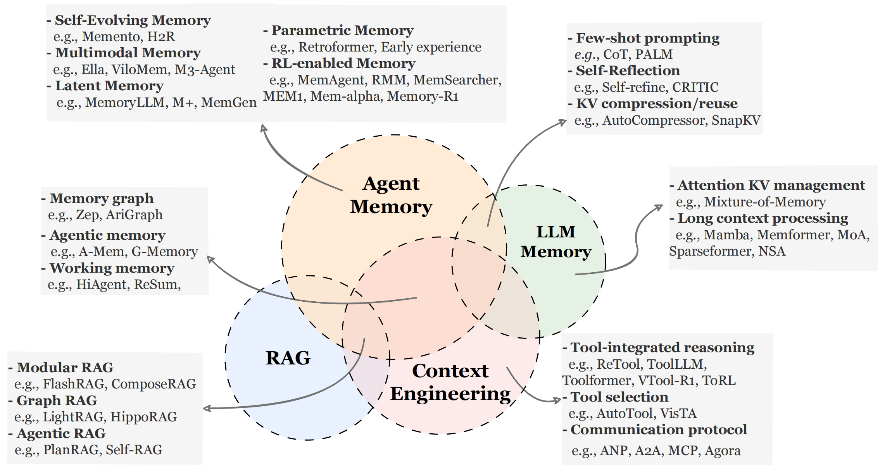

# **[Agent-Memory-Paper-List](https://github.com/Shichun-Liu/Agent-Memory-Paper-List)**



### 1. **Agent Memory（智能体记忆）**

#### 1.1 **Self-Evolving Memory（自进化记忆）** ：比如Memento, H2R

**概念**：查找自[AI知识库cole-medin-knoeledge-base](https://github.com/coleam00/cole-medin-knowledge-base/blob/main/concepts/self-evolving-memory.md)
A memory system that reflects on and rewrites its own notes over time, promoting and pruning what it stores.
一种能够随着时间推移不断反思并重写自身记录的记忆系统，它会对存储的内容进行优化与筛选。

+ 使智能体随着时间演化
+ 与RAG的区别：智能体从自身对话+决策中学习，而不是导入的文档（？什么导入的文档）
  + 预先准备好并一次性导入的外部静态知识源，比如技术手册与API文档，企业知识库，（员工手册，产品规格书，报告……），数据集。
  + RAG的工作流程：文档分块（Chunking）→向量化（Embedding）→存入向量数据库。核心是检索，寻找匹配
  + 从自身对话+决策中学习：指从自身对话，决策，成败学习，核心是反思重写，主动修建
+ “更宏大的目标”：让智能体“在我们与它们互动的过程中学习”——“构建随时间演进的 AI 智能体”（时空进化记忆？

##### 历史上：

提升LLM能力主要依赖监督微调（SFT）或强化学习（RL）来更新模型参数，但有计算成本高昂（调整参数重新训练智能体）、知识更新滞后（模型的知识截止于训练数据，无法在部署后持续吸收用户偏好、环境变化或新出现的任务模式）以及灾难性遗忘（阶段性的训练成果）的风险。而自进化记忆通过进化外部记忆系统来实现能力的持续提升

##### 重要性：

+ 解决简单经验积累导致的记忆污染（冲突感知机制），主动诊断修正记忆，保持记忆库的信噪比
  + 记忆污染属于内容质量问题
  + 交互的原始数据不是全都有用，会有冲突，低效信息，
  + 信噪比=有用信息比/无用信息
  + 冲突感知机制：是哪个模块进行过滤（器：算法模块modules 工具tools）
    + 记忆冲突检测器 数学映射：f(新记忆, 已有记忆) -> 冲突得分/布尔值
    + 记忆效用评分器（评估经验对未来任务的潜在价值，评分依据例如语义重要性，信息密度，元数据加成）；数学映射：f(记忆内容, 当前任务上下文) -> 效用分数 (0.0 ~ 1.0)
    + 记忆压缩器 数学映射：f(多条冗余记忆) -> 单条精简记忆
+ 实现“元进化”（？？）
  + 在云进化之前，自进化针对内容层面，记忆架构不变（检索算法，存储结构）
  + 元进化使智能体的经验知识，记忆架构都进行进化
  + 通过双层循环实现：
    + 内循环：在当前记忆架构进行内容进化
    + 外循环：根据任务表现，调整记忆架构的设计
  + 记忆系统模块化设计空间：编码；存储；检索；管理

##### 关联：
+ Working Memory工作记忆，通过工作记忆筛选，抽象并最终巩固到长期记忆中的经验，才能成为未来学习的素材
    + 工作记忆是受限于上下文的记忆，用于及时决策
    + 强化学习RL：将RL的信号从参数空间（模型权重）转移到上下文/记忆空间，智能体根据任务反馈，动态更新记忆的效用，实现无需重新训练模型的运行时自我进化
    + 奖励信号更新神经网络权重（参数空间）→奖励信号更新外部记忆库中记忆的效用值（Utility/Q
+ RAG: 自进化是RAG的高阶项太，静态rag检索固定知识库，自进化的知识库，检索，都会随交互经验而不断演化

##### 应用：（持续交互，经验积累，个性化适应）

+ 个性化助理，客户反馈；
+ 具身智能
+ 项目协作智能体
+ 在案例中持续学习的专业领域（垂直领域相关）

##### Paper

###### Memento: Fine-tuning LLM Agents without Fine-tuning LLMs

摘要：
In this paper, we introduce a novel learning paradigm for Adaptive Large Language Model (LLM) agents that eliminates the need for fine-tuning the underlying LLMs. Existing approaches are often either rigid, relying on static, handcrafted reflection workflows, or computationally intensive, requiring gradient updates of LLM model parameters. In contrast, our method enables low-cost continual adaptation via memory-based online reinforcement learning. We formalise this as a Memory-augmented Markov Decision Process (M-MDP), equipped with a neural case-selection policy to guide action decisions. Past experiences are stored in an episodic memory, either differentiable or non-parametric. The policy is continually updated based on environmental feedback through a memory rewriting mechanism, whereas policy improvement is achieved through efficient memory reading (retrieval). We instantiate our agent model in the deep research setting, namely  *Memento* , which attains top-1 on GAIA validation (87.88% Pass@3) and 79.40% on the test set. It reaches 66.6% F1 and 80.4% PM on the DeepResearcher dataset, outperforming the state-of-the-art training-based method, while case-based memory adds 4.7% to 9.6% absolute points on out-of-distribution tasks. Our approach offers a scalable and efficient pathway for developing generalist LLM agents capable of continuous, real-time learning without gradient updates, advancing machine learning towards open-ended skill acquisition and deep research scenarios. The code is available at [https://github.com/Agent-on-the-Fly/Memento](https://github.com/Agent-on-the-Fly/Memento).

本文提出了一种全新的自适应大语言模型（LLM）智能体学习范式， 无需对底层大模型进行微调 。现有方案通常存在两种局限：要么过于僵化，依赖静态、人工设计的反思工作流；要么计算开销巨大，需要对LLM模型参数进行梯度更新。相比之下，我们的方法借助基于记忆的在线强化学习 ，实现了低成本的持续自适应。

我们将该过程形式化为记忆增强的马尔可夫决策过程（M-MDP），并配备了一个神经案例选择策略（neural case-selection policy）来指导动作决策。过往经验被存储于情景记忆（episodic memory）中，该记忆既可以是可微的，也可以是非参数的。系统通过记忆重写机制，根据环境反馈不断更新策略；同时，通过高效的记忆读取（即检索操作）来实现策略的改进。

我们将该智能体模型实例化于深度研究（deep research）场景中，命名为Memento。该模型在 GAIA 验证集上以 87.88% 的 Pass@3 成绩夺得第一，在测试集上达到 79.40%。在 DeepResearcher 数据集上，Memento 取得了 66.6% 的 F1 分数和 80.4% 的 PM 分数，性能超越了当前最先进的（SOTA）基于训练的方法。此外，在分布外（OOD）任务中，基于案例的记忆机制带来了 4.7% 至 9.6% 的绝对性能提升。

我们的方法为构建无需梯度更新、具备连续实时学习能力的通用 LLM 智能体*提供了一条可扩展且高效的路径，推动了机器学习向开放式技能获取与深度研究场景的迈进。代码已开源于：[https://github.com/Agent-on-the-Fly/Memento](https://github.com/Agent-on-the-Fly/Memento)。

代码库：https://github.com/Memento-Teams/Memento
复现：
```text

使用命令：

终端内：
git clone https://github.com/Memento-Teams/Memento
cd Memento
pip install -r requirements.txt
OPENAI_API_KEY=（略
python client/agent.py

```
遇到问题：
1.网络超时
2.缺少“包”——重复出现此问题——deepseek建议开虚拟环境
3.api找了阿里云的
4.乱七八糟一堆报错，deepseek越指挥越乱——26.11.27


#### **Multimodal Memory（多模态记忆）** ：比如Ella, ViloMem

#### **Latent Memory（隐空间记忆）** ：比如MemoryLLM

#### **Parametric Memory** ：比如Retroformer，Early experience

#### **RL-enabled Memory** : MemAgent , RMM ,MemSearcher

### 2.**LLM Memory（大模型自身记忆）**

### 3.**RAG（检索增强生成）**

### 4.**Context Engineering（上下文工程）**
